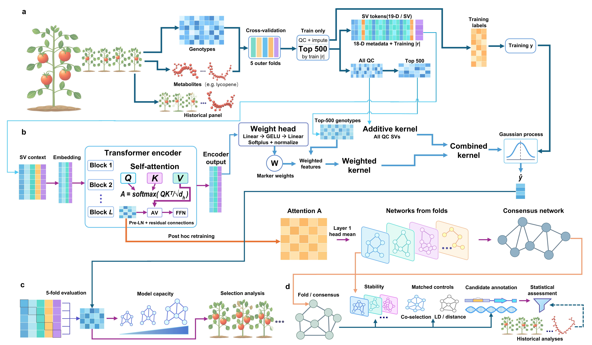

# SVDKL for tomato metabolite prediction from structural variants

SVDKL predicts tomato metabolite levels from genomic structural variant genotypes. This repository provides code to prepare data, train models, and generate predictions for 36 metabolite traits. Start with the Colab example to run prediction and save a prediction table and plot. Prediction runs on a CPU; GPU training is optional.

[](https://colab.research.google.com/github/wyqmath/SVDKL/blob/main/notebooks/SVDKL_quickstart.ipynb)

## Quick start in Colab

| Step | What to do | What you get |
|---|---|---|
| 1. Open Colab | Open the notebook above and run the setup cell to install dependencies. | A ready-to-use runtime. |
| 2. Load model | Choose a model size, starting with **SVDKL-0.01M**, and run the model cell. | Model ready, with the selected model name. Parameters for another trait load automatically when needed. |
| 3. Load input data | Run Input data to load the example input; if missing, click **Prepare example data** to create it from the original sources. | Input data checked and ready for prediction. |
| 4. Run prediction | Start with **SlFM0030 — Cysteine** and run the prediction cell. | The results table, plot and test-set metrics appear immediately. |
| 5. Download results | Click **Download predictions** or **Download figure** beneath the results. | A saved copy of the results table or figure. |

The results table includes training/test roles, observed values, predictions and residuals (prediction errors). The comparison plot and prediction metrics use the 65 test accessions. The plot labels the model, metabolite and test sample count, with Pearson correlation and RMSE alongside it. Download buttons appear immediately. If plotting fails, the CSV is preserved and **Retry figure** redraws it without running prediction again. Saved CSV results can also be redrawn in a new session after setup.

Pretrained model weights are not yet available for download. The pretrained prediction example requires these files. For now, use a model already available in your session. Training and test evaluation are optional sections after the main prediction workflow. Preparation from the original source files is in the notebook’s optional data section; step 3 loads prepared input available in the session.



## Model sizes

| Model size | Paper label | Width / layers | Parameters | Model download |
|---|---|---|---:|---|
| SVDKL-0.01M | SVDKL-0.01M | 32 / 1 | 9,731 | Not yet public |
| SVDKL-4.35M | SVDKL-4M | 512 / 2 | 4,347,395 | Not yet public |
| SVDKL-46.46M | SVDKL-46M | 1,376 / 3 | 46,462,019 | Not yet public |

Pretrained model weights are not yet available for download. When they are published, Colab downloads, unpacks and loads the selected model automatically. A model already available in the session can be loaded under **Advanced**.

The Transformer is the neural component that learns variant weights. Width is its internal feature dimension; layers is the number of encoder blocks. Both determine model size. Each model size supports the same 36 metabolite traits, using a separately trained model for each trait.

Prediction requires the model weights and the reference dataset prepared below. For new samples, also provide their structural variant genotypes as described in the [input format section](#input-format).

## Input data and example split

The example dataset contains 324 tomato accessions and 36 metabolite traits from nine annotated classes. The preparation script extracts the required genotype and phenotype data from the source files. The prepared example input is created at `data/dataset_inputs.npz`; it is not included in the repository or model downloads. In Colab, **Prepare example data** downloads the two population files linked below and creates this input. The same process is available through the local preparation command.

The example uses a fixed split of 259 training accessions and 65 test accessions. Within the training set, 207 accessions are used for fitting and 52 for validation. Validation selects the training duration, after which the model is fitted again using all 259 training accessions. The split uses seed `20261012`.

| Data | Original publication | Download |
|---|---|---|
| Population SV genotypes | Zhou et al. (2022), [Nature](https://doi.org/10.1038/s41586-022-04808-9) | [706.sv.vcf.gz](http://solomics.agis.org.cn/tomato/ftp/genotypes/706.sv.vcf.gz) |
| Integrated phenotypes | Zhou et al. (2022), [Nature](https://doi.org/10.1038/s41586-022-04808-9) | [pheno_exp_meta.txt](http://solomics.agis.org.cn/tomato/ftp/expression/pheno_exp_meta.txt) |
| Metabolite annotations | Zhu et al. (2018), [Cell](https://doi.org/10.1016/j.cell.2017.12.019) | [mmc2.xls](https://ars.els-cdn.com/content/image/1-s2.0-S009286741731499X-mmc2.xls) |
| Measurement identities | Zhu et al. (2018), [Cell](https://doi.org/10.1016/j.cell.2017.12.019) | [mmc5.xlsx](https://ars.els-cdn.com/content/image/1-s2.0-S009286741731499X-mmc5.xlsx) |

Numerical preparation reads the population VCF and integrated phenotype table; the Cell workbooks identify the metabolites. Inputs retain all 106,362 original deletion (DEL) columns in VCF order. Each genotype is encoded as 0, 1 or 2 copies of the alternate deletion allele, with −1 for missing or unsupported calls. Coordinates use SL5.0 and 1-based VCF positions; variant length is `max(REF length − ALT length, 1)`. Phenotypes retain the numerical values of the integrated source table. Training standardization is reversed before prediction is returned, so measured and predicted values share this source-table scale.

The panel contains four metabolites from each of the nine classes listed below. Preparation uses these 36 trait IDs in ascending alphanumeric order.

### Trait IDs and metabolite names

Trait IDs such as `SlFM0030` identify the phenotype columns used for prediction. The names, classes and identification levels below follow the Cell annotation workbook linked above. “Putatively annotated” retains the original annotation confidence. **Source-table measurement** means the processed measurement value in the matching `pheno_exp_meta.txt` column. Predictions are returned on the same scale. Concentration units and upstream transformations are not specified in those columns.

| Trait ID | Metabolite name | Class | Identification level | Phenotype value meaning |
|---|---|---|---|---|
| SlFM0030 | Cysteine | Amino acid | putatively annotated | Source-table measurement |
| SlFM0047 | L-Isoleucine | Amino acid | standard | Source-table measurement |
| SlFM0048 | Ornithine | Amino acid | putatively annotated | Source-table measurement |
| SlFM0069 | Salicylic acid | Polyphenol | putatively annotated | Source-table measurement |
| SlFM0216 | Methoxy indoleacetic acid | Phytohormone | putatively annotated | Source-table measurement |
| SlFM0222 | Chalcone | Flavonoid | putatively annotated | Source-table measurement |
| SlFM0244 | Acetyl-serotonin | Amino acid derivative | putatively annotated | Source-table measurement |
| SlFM0259 | 2'-Deoxycytidine | Nucleic acid derivative | putatively annotated | Source-table measurement |
| SlFM0275 | L-Homocarnosine | Amino acid | putatively annotated | Source-table measurement |
| SlFM0336 | ABA | Phytohormone | putatively annotated | Source-table measurement |
| SlFM0346 | Homocystine | Amino acid derivative | standard | Source-table measurement |
| SlFM0386 | N-(9H-Purin-6-ylcarbamoyl)threonine | Nucleic acid derivative | putatively annotated | Source-table measurement |
| SlFM0416 | IAA-Asp | Phytohormone | putatively annotated | Source-table measurement |
| SlFM0421 | Catechin | Flavonoid | standard | Source-table measurement |
| SlFM0430 | N-Sinapoylputrescine | Polyamine | putatively annotated | Source-table measurement |
| SlFM0438 | 2'-O-methylguanosine | Nucleic acid derivative | putatively annotated | Source-table measurement |
| SlFM0502 | N-Feruloyltyramine | Amino acid derivative | putatively annotated | Source-table measurement |
| SlFM0533 | p-Coumaric acid 4-O-hexoside | Polyphenol | putatively annotated | Source-table measurement |
| SlFM0555 | GA7-1 | Phytohormone | putatively annotated | Source-table measurement |
| SlFM0577 | 4-Coumaroylquinic acid | Polyphenol | putatively annotated | Source-table measurement |
| SlFM0625 | Adenosine 3'-monophosphate | Nucleic acid derivative | standard | Source-table measurement |
| SlFM0716 | Sinapaldehyde glucoside | Polyphenol | putatively annotated | Source-table measurement |
| SlFM0778 | S-Adenosyl-L-homocysteine | Amino acid derivative | putatively annotated | Source-table measurement |
| SlFM0982 | Naringenin C-hexoside | Flavonoid | putatively annotated | Source-table measurement |
| SlFM1384 | Quercetin O-malonylhexoside | Flavonoid | putatively annotated | Source-table measurement |
| SlFM1470 | Cyanidin 3-rutinoside | Anthocyanin | putatively annotated | Source-table measurement |
| SlFM1542 | Petunidin 3-O-rutinoside | Anthocyanin | putatively annotated | Source-table measurement |
| SlFM1553 | N', N'', N'''-Di-p-coumaroyl, sinapoylagmatine | Polyamine | putatively annotated | Source-table measurement |
| SlFM1619 | N', N'', N'''-Diferuloyl, caffeoylspermidine | Polyamine | putatively annotated | Source-table measurement |
| SlFM1621 | N', N'', N'''-p-hydroxybenxoyl,caffeoyl, feruloylagmatine | Polyamine | putatively annotated | Source-table measurement |
| SlFM1804 | Dihydroxy tomatidine-O-hexosyl-O-rhamnoside | Glycoalkaloid | putatively annotated | Source-table measurement |
| SlFM1826 | Delphinidin 3-sophoroside-5-rhamnoside | Anthocyanin | putatively annotated | Source-table measurement |
| SlFM1952 | Ferulylpelargonidin di-O-hexosyl-O-pentoside | Anthocyanin | putatively annotated | Source-table measurement |
| SlFM1980 | Habrochaitoside A | Glycoalkaloid | putatively annotated | Source-table measurement |
| SlFM1984 | Lycoperoside H | Glycoalkaloid | putatively annotated | Source-table measurement |
| SlFM1988 | Lycoperoside C | Glycoalkaloid | putatively annotated | Source-table measurement |

### Sample inclusion

The source cohort contains 332 accessions. Preparation retains the 324 accessions with finite measurements for all 36 selected traits. Five accessions lack all 36 measurements (SL126, SL198, SL227, SL275 and SL439); three lack SlFM0030 (SL237, SL246 and SL251).

## Run locally

Use Python 3.12. Clone the repository and install the four core dependencies:

```bash
git clone https://github.com/wyqmath/SVDKL.git
cd SVDKL
python -m pip install torch==2.8.0 --index-url https://download.pytorch.org/whl/cpu
python -m pip install numpy==2.3.5 scipy==1.17.1 threadpoolctl==3.6.0
```

Training environment: Python 3.12.3, PyTorch 2.8.0 with CUDA 12.8, NumPy 2.3.5, SciPy 1.17.1, and threadpoolctl 3.6.0. Training used an NVIDIA RTX 5090. Use the CPU build of PyTorch for CPU prediction and the CUDA build for GPU training.

For GPU training, use `--index-url https://download.pytorch.org/whl/cu128` for the PyTorch installation. Colab uses its preinstalled PyTorch/CUDA environment, displays the active versions, and installs Matplotlib for plots and ipywidgets for download buttons as needed.

### 1. Prepare data

Place the two population files in `data/`, then run:

```bash
python -m src.prepare_data --vcf data/706.sv.vcf.gz --phenotypes data/pheno_exp_meta.txt --output data/dataset_inputs.npz
```

### 2. Load a model and predict

Place the model for the selected model size and trait at `weights/<model size>/<trait ID>.pt`. For example, use `weights/SVDKL-0.01M/SlFM0030.pt` for SVDKL-0.01M and SlFM0030, then run:

```bash
python -m src.predict --checkpoint weights/SVDKL-0.01M/SlFM0030.pt --data data/dataset_inputs.npz --model SVDKL-0.01M --trait SlFM0030 --device cpu --output predictions_SlFM0030.csv
```

`predictions_SlFM0030.csv` is the filename explicitly set by `--output` in this command. The CSV contains `accession` and `prediction` columns. Replace the model size and trait ID to use another model. Existing outputs are preserved; choose a new filename for another run.

#### Input format

For the example, use the reference dataset created by the preparation command. It contains `dosage`, `accessions`, `traits`, `phenotypes`, `marker_id`, `chrom`, `pos` and `svlen`. For new samples, provide an NPZ containing `dosage`, `marker_id` and `accessions`, and use the reference dataset separately:

```bash
python -m src.predict --checkpoint weights/SVDKL-0.01M/SlFM0030.pt --data query.npz --reference-data data/dataset_inputs.npz --model SVDKL-0.01M --trait SlFM0030 --output query_predictions.csv
```

Query markers are aligned by ID.

### 3. Train or evaluate (optional)

Train the selected trait, or set `--trait all` to fit all 36:

```bash
python -m src.train --model SVDKL-0.01M --trait SlFM0030 --fold 0 --data data/dataset_inputs.npz --device cuda:0 --output results
```

Use `--device cuda:0` for the first CUDA GPU or `--device cpu` for CPU training. `--fold 0` selects the provided fixed split: 259 training and 65 test accessions, with 207 fitting and 52 validation accessions inside training. Training runs for up to 105 epochs. Validation selects the final epoch count, and a newly initialized model is then fitted for that many epochs using all 259 training accessions.

Optional flags: `--save-optimizer` also saves the final optimizer state. `--resume` verifies and skips completed traits; it does not restore an interrupted training epoch.

Evaluate after loading the 36 trait models for one model size:

```bash
python -m src.score --results weights --data data/dataset_inputs.npz --model SVDKL-0.01M --output metrics_SVDKL-0.01M.json
```

Evaluation uses the fixed 65 test accessions. Pearson correlation measures linear association between observed and predicted values; Spearman correlation measures rank association. Root mean squared error (RMSE) and mean absolute error (MAE) measure prediction error. Both errors are divided by the sample standard deviation (SD) of the training labels, calculated with `ddof=1`. Metrics are calculated per trait and averaged equally across traits; constant predictions receive correlation zero. Use `--model all` to evaluate all three model sizes when their weights are available.


### Default Colab results

Use **SVDKL-0.01M**, **SlFM0030 — Cysteine** and **Pretrained weights** for the first example.

| Output | First-run location or content |
|---|---|
| Prediction table | `predictions/pretrained_SVDKL-0.01M_SlFM0030.csv` |
| Prediction columns | `accession` and `prediction`; model, trait, role and measured-value columns support saved-result plotting |
| Prediction rows | 324 with the complete example input |
| Prediction plot | `predictions/pretrained_SVDKL-0.01M_SlFM0030_plot.png` |
| Plotted samples | 65 test accessions from the fixed split |
| Full evaluation | `metrics_pretrained_SVDKL-0.01M.json`; requires weights for all 36 traits |

Repeated prediction adds a run number, for example `pretrained_SVDKL-0.01M_SlFM0030_run2.csv` and `pretrained_SVDKL-0.01M_SlFM0030_run2_plot.png`. Download the table or figure with the buttons beside the results. A saved Colab prediction CSV can be redrawn after setup in a new session.

## Method

Quality control (QC) uses training genotypes to retain variable deletions with minor-allele frequency (MAF) > 0.05 and missingness < 0.20. A relationship kernel summarizes genetic similarity across all passing deletions. A second kernel uses 500 variants selected within training; a Transformer assigns their weights from 19-dimensional variant descriptors. Gaussian process regression combines the two sources of similarity to predict each metabolite. The Transformer and two-layer weight head are fitted by minimizing marginal negative log-likelihood, which measures how well the Gaussian process model describes the training phenotypes. QC, missing-value imputation, variant selection and phenotype scaling are fitted within each training partition.

## Paper

*Deep kernel learning predicts complex traits and prioritizes candidate loci from pangenome structural variation in tomato*.

## Repository structure

```text
SVDKL/
├── README.md
├── assets/fig1.jpg
├── notebooks/SVDKL_quickstart.ipynb
└── src/
    ├── prepare_data.py
    ├── model.py
    ├── train.py
    ├── predict.py
    └── score.py
```
